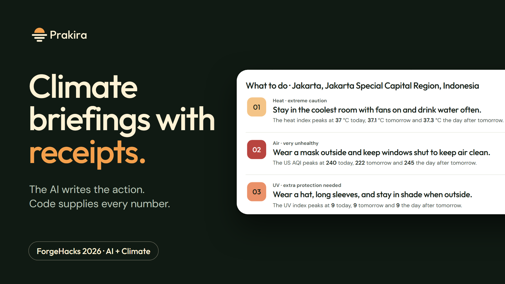
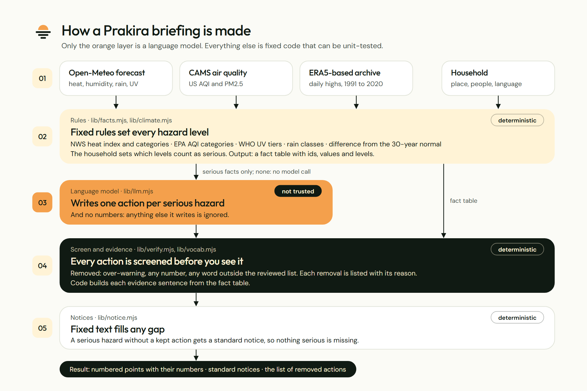
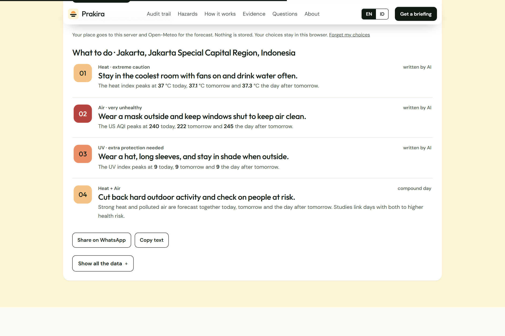
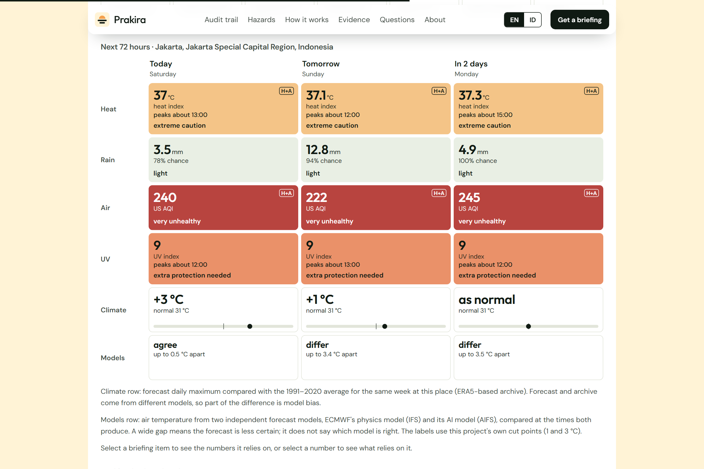
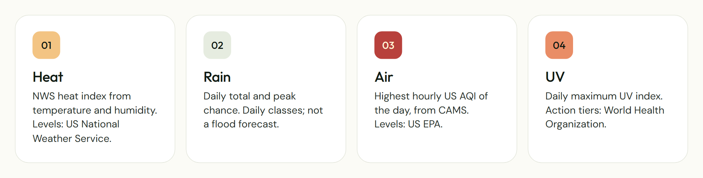
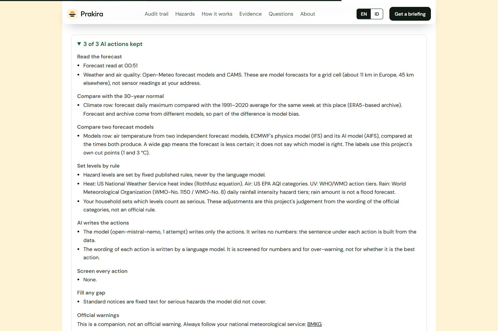
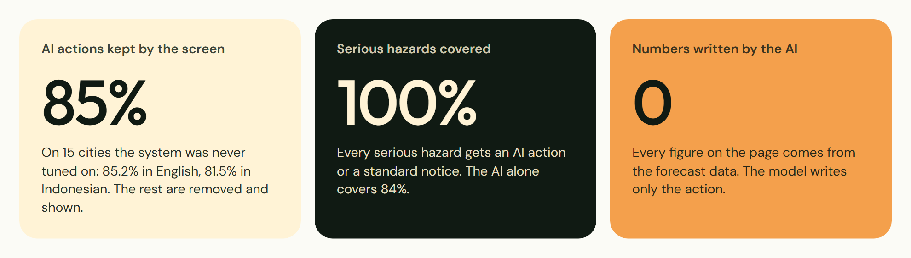

# ClimateGuard
### AI-powered, household-specific climate risk briefings

<p align="center">
  
</p>

<p align="center">
  
  
  
  
</p>

**ClimateGuard** transforms weather forecasts and environmental data into practical, household-specific climate risk briefings. It helps people understand upcoming heat, rainfall, air quality, and UV risks, and provides actionable guidance based on household circumstances.

Rather than simply displaying weather numbers, ClimateGuard explains what those conditions could mean for people and what precautions they can consider taking.

---

## Table of Contents

- [Overview](#overview)
- [Problem Statement](#problem-statement)
- [Our Solution](#our-solution)
- [Key Features](#key-features)
- [How ClimateGuard Works](#how-climateguard-works)
- [System Architecture](#system-architecture)
- [Technology Stack](#technology-stack)
- [Environmental Data Sources](#environmental-data-sources)
- [Evaluation and Testing](#evaluation-and-testing)
- [Screenshots](#screenshots)
- [Project Structure](#project-structure)
- [Installation and Setup](#installation-and-setup)
- [Environment Variables](#environment-variables)
- [Limitations and Responsible Use](#limitations-and-responsible-use)
- [Project Background and Attribution](#project-background-and-attribution)

---

## Overview

Climate change and increasingly unpredictable weather conditions create challenges for households, particularly those with children, older adults, and people who may be more vulnerable to environmental hazards.

Traditional weather applications primarily communicate forecasts through temperatures, rainfall probabilities, and air quality measurements. However, these figures do not always explain their practical implications for a particular household.

ClimateGuard bridges this gap by combining:

- Weather forecasting data.
- Air quality information.
- Ultraviolet radiation measurements.
- Household vulnerability information.
- Rule-based environmental risk assessment.
- AI-generated natural-language recommendations.

The platform converts these inputs into a concise briefing covering the next 72 hours.

## Problem Statement

Weather information is widely available, but interpreting its consequences can be difficult.

For example:

- A high heat index may create additional risks for older adults.
- Heavy rainfall may disrupt outdoor activities and travel.
- Poor air quality may require additional precautions for sensitive individuals.
- High UV exposure may increase the need for sun protection.

Most general-purpose weather applications provide environmental measurements without sufficiently connecting them to individual household circumstances.

Furthermore, AI-generated recommendations can sometimes contain inaccurate figures or unsupported claims if numerical information is generated directly by a language model.

ClimateGuard addresses these challenges through a combination of deterministic calculations, environmental thresholds, and carefully screened AI-generated advice.

## Our Solution

ClimateGuard creates personalized climate briefings by analysing environmental conditions alongside household characteristics.

The system follows an important design principle:

**Code determines the numbers and risk levels. AI is responsible only for generating the practical action wording.**

This separation helps prevent language models from inventing temperatures, air quality values, hazard levels, or other numerical evidence.

Each briefing presents:

1. Important environmental risks.
2. Household-specific risk classifications.
3. Practical recommendations.
4. Supporting forecast measurements.
5. The reasoning and evidence behind the recommendations.

The platform also provides an audit trail so users can understand how the briefing was generated.

---

## Key Features

### 1. Multi-hazard climate monitoring

ClimateGuard monitors four important environmental hazards.

| Hazard | Information analysed |
|---|---|
| Heat | Hourly temperature and humidity-derived heat index |
| Rain | Daily rainfall totals and precipitation probability |
| Air Quality | Maximum hourly US Air Quality Index |
| UV Radiation | Daily maximum UV index |

### 2. Household-specific risk assessment

Users can provide household information to adjust the risk assessment.

The system considers circumstances such as:

- Older adults.
- Young children.
- People with relevant health vulnerabilities.
- Household cooling conditions.

The selected household characteristics influence which environmental thresholds are treated as serious.

### 3. AI-generated recommendations

ClimateGuard uses the Mistral language model to generate short, understandable recommendations.

The AI is instructed to generate action-oriented advice rather than numerical measurements.

Its output is screened before being presented to the user.

### 4. Transparent risk calculations

Hazard levels are determined through fixed rules rather than AI-generated classifications.

The platform displays supporting environmental measurements and the associated risk categories.

### 5. 72-hour climate briefing

Users receive an overview of upcoming environmental conditions across the next three days.

The briefing prioritizes important actions instead of overwhelming users with raw forecast information.

### 6. AI output screening

AI-generated recommendations are treated as untrusted input.

The screening process checks whether recommendations:

- Correspond to a serious hazard.
- Contain prohibited numerical values.
- Use appropriate language for the hazard.
- Avoid unjustified warnings.
- Follow the reviewed vocabulary rules.

### 7. Audit trail and process transparency

The platform records the steps involved in generating a briefing.

Users can inspect the processing sequence, supporting evidence, and information about recommendations that were removed.

### 8. Multiple language support

The original implementation supports:

- English.
- Bahasa Indonesia.

### 9. Climate baseline comparison

Forecast temperatures can be compared with historical climate averages for the corresponding period.

The baseline uses the 1991–2020 reference period.

### 10. Forecast model comparison

The platform compares ECMWF's IFS physics-based forecast model with its AIFS machine-learning forecast model.

Significant differences are presented as an indication of lower confidence rather than automatically selecting one model as correct.

### 11. Additional capabilities

- Location-based weather information.
- Household preference storage in the browser.
- WhatsApp sharing.
- Copy briefing as text.
- Hourly heat and UV peak identification.
- Long-range climate outlook.
- Standard notices for serious hazards without an accepted AI recommendation.

---

## How ClimateGuard Works

The application follows a structured processing pipeline.

### Step 1: Environmental data collection

The system retrieves weather, air quality, and historical climate information through Open-Meteo.

The collected information includes:

- Temperature.
- Relative humidity.
- Precipitation.
- Rain probability.
- Air quality measurements.
- UV index.
- Historical climate averages.

### Step 2: Rule-based risk calculation

The application calculates environmental measurements and determines hazard levels using predefined thresholds.

Examples include:

- Heat index calculation using the NWS Rothfusz equation.
- Air quality classification using EPA categories.
- UV classification based on WHO guidance.
- Rainfall classification using the implemented rainfall thresholds.

### Step 3: Household vulnerability assessment

The system evaluates the environmental conditions in relation to the household information supplied by the user.

Household characteristics can change which risk levels are considered serious.

### Step 4: AI recommendation generation

The Mistral model receives the relevant hazard information and generates concise recommendations.

The model is not responsible for calculating hazard levels or writing numerical evidence.

### Step 5: Recommendation screening

The generated recommendations pass through a screening process.

Recommendations that fail the configured checks are removed.

### Step 6: Evidence generation

The application attaches forecast values, rule-based classifications, and supporting evidence to accepted recommendations.

Numerical statements are constructed by application code using the retrieved environmental data.

### Step 7: Final briefing

The user receives a structured briefing containing the most relevant precautions and the information supporting each recommendation.

---

## System Architecture

<p align="center">
  
</p>

The architecture separates environmental data processing, deterministic calculations, AI recommendation generation, and output verification.

| Layer | Responsibility |
|---|---|
| Data Layer | Retrieves weather, air quality, and climate data |
| Calculation Layer | Calculates environmental measurements and hazard levels |
| Household Layer | Applies household-specific risk adjustments |
| AI Layer | Generates natural-language recommendations |
| Verification Layer | Screens and validates AI-generated actions |
| Evidence Layer | Attaches numerical evidence and supporting information |
| Presentation Layer | Displays the final climate briefing |

### Core processing modules

- `lib/facts.mjs` – Environmental data processing and hazard calculations.
- `lib/climate.mjs` – Historical climate comparisons.
- `lib/llm.mjs` – AI recommendation generation.
- `lib/intake.mjs` – Household description processing.
- `lib/verify.mjs` – Recommendation screening and evidence generation.
- `lib/notice.mjs` – Standardized hazard notices.
- `lib/trace.mjs` – Processing trace and execution timing.
- `lib/models.mjs` – Forecast model comparison.
- `lib/outlook.mjs` – Long-range climate outlook.
- `lib/power.mjs` – NASA POWER data integration.
- `lib/vocab.mjs` – Reviewed recommendation vocabulary.

---

## Technology Stack

| Technology | Purpose |
|---|---|
| Node.js | Application runtime and server |
| JavaScript | Application logic |
| HTML | User interface structure |
| CSS | Interface styling |
| Vanilla JavaScript | Frontend interactions |
| Mistral AI API | Natural-language recommendations |
| Open-Meteo API | Weather and air quality data |
| ECMWF IFS | Physics-based forecast data |
| ECMWF AIFS | Machine-learning forecast comparison |
| CAMS | Atmospheric composition and air quality data |
| NASA POWER | Alternative historical climate data |

---

## Environmental Data Sources

ClimateGuard uses publicly available environmental information and established classification references.

| Category | Reference |
|---|---|
| Heat index | National Weather Service |
| Air quality | United States Environmental Protection Agency |
| UV index | World Health Organization |
| Weather forecasts | Open-Meteo |
| Atmospheric composition | Copernicus Atmosphere Monitoring Service |
| Historical climate baseline | ERA5-based Open-Meteo archive |
| Alternative climate data | NASA POWER |

Reference documentation:

- [National Weather Service – Heat Index](https://www.weather.gov/ama/heatindex)
- [EPA – Air Quality Index](https://www.airnow.gov/aqi/aqi-basics/)
- [WHO – UV Index](https://www.who.int/news-room/questions-and-answers/item/radiation-the-ultraviolet-(uv)-index)
- [Open-Meteo Documentation](https://open-meteo.com/en/docs)
- [NASA POWER](https://power.larc.nasa.gov/)

**Important:** The rainfall thresholds in the underlying implementation are not fully verified against a primary official source. They should not be interpreted as an official flood-warning classification.

---

## Evaluation and Testing

The original project evaluation examined the screening of AI-generated recommendations across English and Indonesian test cases.

The following figures are from the evaluation described in the source project documentation, not a new independent evaluation of ClimateGuard.

| Metric | English – Tuned | English – Held-out | Indonesian – Tuned | Indonesian – Held-out |
|---|---:|---:|---:|---:|
| AI actions accepted by screening | 76.7% | 85.2% | 90.7% | 81.5% |
| Serious hazards covered by accepted AI action | 76.3% | 84.2% | 89.8% | 84.2% |
| Serious hazards covered after notices | 100% | 100% | 100% | 100% |
| AI-generated numbers displayed | 0 | 0 | 0 | 0 |

### Understanding the results

- An accepted recommendation has passed the implemented screening rules; this does not establish that the advice is clinically or scientifically optimal.
- Standard notices cover serious hazards for which an AI recommendation is not accepted.
- The zero-number result follows from the system's design: application code, not the AI, supplies numerical evidence.
- The evaluation used relatively small samples and should not be treated as a large-scale validation.
- The advice has not undergone independent clinical review.

The original project documentation reports 43 offline unit tests. Run the test command to verify the current repository's results.

---

## Screenshots

### Main landing page

<p align="center">
  
</p>

### Climate briefing results

<p align="center">
  
</p>

### Environmental data overview

<p align="center">
  
</p>

### Hazard classification

<p align="center">
  
</p>

### Recommendation audit trail

<p align="center">
  
</p>

### Additional interface views

<p align="center">
  
</p>

---

## Project Structure

```text
ClimateGuard/
│
├── public/
│   ├── index.html
│   └── about.html
│
├── lib/
│   ├── facts.mjs
│   ├── climate.mjs
│   ├── llm.mjs
│   ├── intake.mjs
│   ├── verify.mjs
│   ├── notice.mjs
│   ├── trace.mjs
│   ├── outlook.mjs
│   ├── power.mjs
│   ├── vocab.mjs
│   ├── models.mjs
│   ├── store.mjs
│   ├── readability.mjs
│   └── *.test.mjs
│
├── eval/
│   └── run.mjs
│
├── docs/
│   ├── screenshots/
│   ├── architecture/
│   └── project documentation
│
├── scripts/
│   └── ui-check.cjs
│
├── server.mjs
├── package.json
├── .gitignore
└── README.md
```

*The structure above describes the documented application modules. Check the actual repository for any files that differ.*

---

## Installation and Setup

### Prerequisites

Install the following:

- Node.js 20 or newer.
- Git.
- A Mistral API key.

### 1. Clone the repository

```bash
git clone https://github.com/vihashini-18/ClimateGuard.git
cd ClimateGuard
```

### 2. Configure the API key

Create a `.env` file in the project root:

```env
MISTRAL_API_KEY=your_mistral_api_key
```

Obtain an API key from:

https://console.mistral.ai/

Never publish your actual API key or commit it to GitHub.

### 3. Start the application

```bash
npm start
```

Open the application in your browser:

```text
http://localhost:3000
```

### 4. Run the tests

```bash
npm test
```

### 5. Run the evaluation

```bash
npm run eval -- 15 en heldout
```

The evaluation command accepts the following arguments:

```text
[count] [en|id] [tuned|heldout]
```

---

## Environment Variables

| Variable | Description | Default |
|---|---|---|
| `MISTRAL_API_KEY` | API key for Mistral AI | Required |
| `MISTRAL_MODEL` | Language model identifier | `open-mistral-nemo` |
| `PORT` | Server port | `3000` |
| `HOST` | Server host | `127.0.0.1` |

---

## Limitations and Responsible Use

ClimateGuard is designed as an informational climate-risk companion.

It is not an official meteorological warning service, a replacement for national weather agencies, or a medical advice platform.

Important limitations include:

1. **Forecast uncertainty:** Environmental information comes from forecast models and may differ from actual local conditions.
2. **AI recommendations:** Screening reduces certain unwanted outputs but does not guarantee that every recommendation is optimal.
3. **Household thresholds:** Household adjustments are project-specific interpretations, not official medical thresholds.
4. **Rainfall classification:** Implemented rainfall categories should not be treated as official flood predictions.
5. **Air quality resolution:** CAMS data has different spatial resolutions across regions.
6. **Climate comparisons:** Forecast and historical datasets may use different models and grids.
7. **Model availability:** External APIs and free-tier services may be rate-limited or temporarily unavailable.

Users should follow official local warnings and consult qualified professionals when necessary.

---

## Project Background and Attribution

ClimateGuard is based on the Prakira project and its existing implementation. The repository's Git history has been reset, but that does not change the project's original development history or authorship.

Original project: [Prakira](https://github.com/rofiperlungoding/prakira)

Please retain applicable original author attribution, copyright notices, and licence requirements. Check the original repository's licence before redistributing or modifying the software.

---

<p align="center">
  <strong>ClimateGuard</strong><br>
  Turning environmental data into understandable, actionable climate awareness.
</p>
